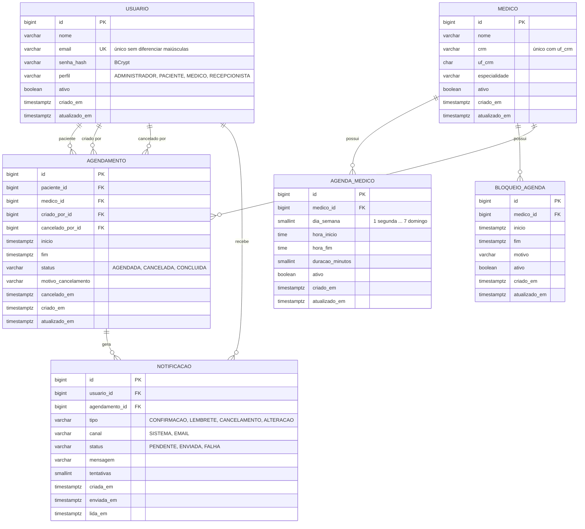

# Modelagem de dados — Agendamentos SA

Versão 1.1 — 15/11/2026. Substitui a proposta de 27/10.

Situação: a migração V1 está no backend (`src/main/resources/db/migration`) e já foi aplicada no PostgreSQL de desenvolvimento do Yuri. A V2 ampliou os perfis de usuário. Este documento descreve o banco como ele está no repositório do backend. Onde cada ambiente roda está em [AMBIENTES.md](AMBIENTES.md).

## Mudanças desde a versão 1

- Clientes: painel web (React + Vite) e aplicativo React + Capacitor (Android), conforme decisão do grupo de 15/11. O banco não muda com isso: os dois clientes usam a mesma API e nenhum acessa o banco direto.
- Perfis: a V2 trocou `ADMIN` por `ADMINISTRADOR` e passou a aceitar `MEDICO` e `RECEPCIONISTA`. Na versão 1 do sistema esses dois ficam reservados (ver "Perfis").
- Datas de criação e atualização: confirmado que o PostgreSQL cuida delas (padrão `CURRENT_TIMESTAMP` e gatilho). O Hibernate só lê (`@Generated`), como já está nas entidades.
- Novos materiais: script de validação das restrições ([validacao_restricoes.sql](validacao_restricoes.sql)) e dados de demonstração para desenvolvimento (`R__dados_demonstracao.sql` no backend, perfil `dev`).
- Decisões pendentes da versão 1 agora têm proposta (ver o fim do documento).

## Decisões estruturais

| Decisão | Versão 1.1 | Justificativa |
|---|---|---|
| Banco | PostgreSQL 16+ | Confirmado: Flyway no backend e V1 aplicada. Integridade transacional e restrição de conflito de horários no próprio banco. |
| Migrações | Flyway, `ddl-auto=validate` | O banco é definido pelas migrações; o Hibernate só confere se as entidades batem com ele. |
| Clientes | Painel web e app React + Capacitor | Os dois consomem a mesma API REST. |
| Perfis com uso na v1 | `ADMINISTRADOR` e `PACIENTE` | São os perfis citados nos requisitos funcionais. |
| Perfis reservados | `MEDICO` e `RECEPCIONISTA` | Aceitos pela V2, sem permissões próprias na v1. |
| Médico | Entidade sem login | Gerenciado pelo administrador. Não há vínculo entre `medico` e `usuario`. |
| Especialidade | Atributo de médico | Evita CRUD e tabela adicionais antes de existir necessidade real. |
| Unidade de saúde | Fora da versão 1 | Uma única clínica (arquitetura do backend: "apenas um consultório"). |
| Histórico | Derivado de `agendamento` | Cancelados e concluídos permanecem na mesma tabela. Não há prontuário. |
| Exclusão de médico/usuário | Desativação lógica | Preserva vínculos e histórico administrativo. |
| Horário | `TIMESTAMPTZ` | Guarda o instante correto; os clientes exibem em `America/Sao_Paulo`. |
| Concorrência | Restrição de exclusão (GiST) | Dois pedidos simultâneos não conseguem reservar o mesmo médico ou paciente no mesmo intervalo. |
| Datas de auditoria | Banco (padrão + gatilho) | Funcionam também em alterações feitas fora da aplicação. |

## Migrações

Os arquivos ficam no backend, em `src/main/resources/db/migration` (V) e `src/main/resources/db/dev` (R). Mudança de estrutura só entra por nova migração revisada em PR; ninguém altera tabela à mão em produção.

| Versão | Arquivo | Autor | Conteúdo |
|---|---|---|---|
| V1 | `V1__criar_estrutura_inicial.sql` | Luís | Tabelas, restrições, índices e gatilhos descritos aqui. |
| V2 | `V2__atualizar_perfis_usuario.sql` | Yuri | `ADMIN` vira `ADMINISTRADOR`; perfis aceitos: `ADMINISTRADOR`, `PACIENTE`, `MEDICO`, `RECEPCIONISTA`. |
| R (dev) | `R__dados_demonstracao.sql` | Luís | Dados fictícios para desenvolvimento e demonstração. Só roda com o perfil `dev`, nunca em produção. |

A extensão `btree_gist`, criada pela V1, é confiável desde o PostgreSQL 13: o dono do banco consegue criá-la sem superusuário. O Neon, usado em produção, oferece a extensão.

## Diagrama entidade-relacionamento

## Dicionário e regras por entidade

### `usuario`

- Guarda credenciais e dados comuns de quem acessa o sistema.
- `email` é único sem diferenciar maiúsculas e minúsculas (índice em `lower(email)`); a API grava em minúsculas.
- `senha_hash` guarda o hash BCrypt e nunca aparece nas respostas da API.
- `perfil`: ver "Perfis".
- Um usuário desativado não pode autenticar nem criar agendamentos.

### Perfis

| Perfil | Uso na versão 1 |
|---|---|
| `ADMINISTRADOR` | Gerencia médicos, agendas, bloqueios, pacientes e qualquer agendamento. |
| `PACIENTE` | Cadastra-se, agenda, cancela e reagenda as próprias consultas e vê o próprio histórico. |
| `MEDICO` | Reservado. Não tem permissões próprias e não está ligado à tabela `medico`. |
| `RECEPCIONISTA` | Reservado. Não tem permissões próprias. |

Se o médico passar a entrar no sistema (por exemplo, para ver a própria agenda), será preciso uma nova migração com `medico.usuario_id` (único, opcional, referência a `usuario`) e as regras de acesso correspondentes. Até lá, um usuário com perfil `MEDICO` ou `RECEPCIONISTA` não deve receber acesso além do de um usuário autenticado sem perfil administrativo.

### `medico`

- `crm` é único em conjunto com `uf_crm`; `uf_crm` aceita duas letras maiúsculas.
- Desativar impede novos horários e agendamentos, mas não remove o histórico.
- Não armazena senha nem perfil de autenticação.

### `agenda_medico`

- Define janelas semanais recorrentes de atendimento.
- `dia_semana` usa ISO-8601: 1 = segunda-feira e 7 = domingo.
- Pode existir mais de uma janela por dia, por exemplo 08:00–12:00 e 13:30–18:00. A mesma janela não se repete para o médico.
- `duracao_minutos` (5 a 480) determina a geração de horários disponíveis.

### `bloqueio_agenda`

- Representa férias, reunião, ausência ou bloqueio pontual.
- Um bloqueio ativo retira do resultado qualquer horário que o intercepte.
- A desativação substitui a exclusão física.

### `agendamento`

- Vínculo obrigatório entre paciente, médico e intervalo de atendimento.
- `status` aceita `AGENDADA`, `CANCELADA` ou `CONCLUIDA`.
- A reserva usa intervalo semiaberto `[inicio, fim)`: uma consulta pode começar exatamente quando a anterior termina.
- O banco impede sobreposição de consultas `AGENDADA` para o mesmo médico e para o mesmo paciente. Consultas canceladas ou concluídas não bloqueiam o horário.
- Uma consulta cancelada exige `cancelado_em` e `cancelado_por_id`; as demais não podem tê-los.
- `criado_por_id` distingue um agendamento criado pelo paciente de um criado pelo administrador.
- O reagendamento altera o intervalo da mesma linha e atualiza `atualizado_em`; cancelamentos permanecem para o histórico.
- Não há sintomas, diagnóstico, prescrição ou prontuário.

### `notificacao`

- Mantém o registro exigido pelo RF-028.
- `tipo`: `CONFIRMACAO`, `LEMBRETE`, `CANCELAMENTO` ou `ALTERACAO`.
- `canal`: `SISTEMA` ou `EMAIL`.
- `status`: `PENDENTE`, `ENVIADA` ou `FALHA`; `tentativas` conta as tentativas de envio.

## Notificações assíncronas (conceito de sistemas distribuídos)

A SA pede ao menos um conceito distribuído aplicado e justificado (offline, cache, mensageria ou sincronização). O banco já suporta um deles sem tabela nova: a **caixa de saída transacional** (*transactional outbox*).

1. Ao confirmar, cancelar ou reagendar, o serviço grava o agendamento e a notificação `PENDENTE` na mesma transação. Ou tudo é gravado, ou nada.
2. Um processo separado (agendador do Spring ou consumidor de fila) lê as notificações `PENDENTE` pelo índice `ix_notificacao_pendente`, envia, marca `ENVIADA` com `enviada_em` ou incrementa `tentativas` e marca `FALHA`.
3. O envio não atrasa nem derruba a operação do paciente: se o canal estiver fora do ar, a consulta continua marcada e a notificação é reenviada depois.

Para mais de uma instância do processo de envio, a leitura usa `SELECT ... FOR UPDATE SKIP LOCKED`, de modo que duas instâncias não enviem a mesma notificação.

## Regras que ficam na aplicação

As validações abaixo dependem de contexto e devem rodar numa transação no backend:

1. O paciente do agendamento deve ser um `usuario` ativo com perfil `PACIENTE`.
2. O médico deve estar ativo.
3. O intervalo precisa caber integralmente em uma janela ativa de `agenda_medico`.
4. O intervalo não pode interceptar `bloqueio_agenda` ativo.
5. O início deve ser futuro no momento da confirmação.
6. O fim deve corresponder à duração configurada na janela.
7. Cancelamento e reagendamento exigem o próprio paciente ou um `ADMINISTRADOR`.
8. O histórico do paciente sempre filtra pelo usuário autenticado.
9. Quem reserva bloqueia antes a linha do médico (`SELECT ... FOR UPDATE`), como já faz o módulo de agendas, para não reservar enquanto a agenda ou um bloqueio está sendo alterado.

## Validação

- [validacao_restricoes.sql](validacao_restricoes.sql) roda numa transação e desfaz tudo no fim. Ele confere e-mail duplicado, perfis, CRM duplicado, janelas e bloqueios inválidos, sobreposição de consultas por médico e por paciente, consultas encostadas, liberação do horário no cancelamento, regras de cancelamento, valores aceitos nas notificações e a existência dos gatilhos. Cada verificação imprime `OK`; a primeira que falhar interrompe com `FALHOU`.
- Concorrência real (duas conexões ao mesmo tempo) não cabe num script só. O roteiro manual está no fim do arquivo.

## Decisões da versão 1 (DEC-02 e DEC-03)

| Item | Situação |
|---|---|
| PostgreSQL como banco definitivo | Decidido |
| Clínica única, sem tabela de unidade | Decidido |
| Médico sem login na v1 | Decidido; `MEDICO` fica reservado |
| Especialidade como atributo de médico | Decidido |
| Duração inicial das consultas | Proposta: 30 minutos, configurável por janela |
| Notificações | Proposta: canal `SISTEMA` (lista no app) na v1; `EMAIL` só se sobrar tempo |
| Lembrete | Proposta: 24 horas antes da consulta |
| Antecedência para cancelar ou reagendar | Proposta: sem antecedência mínima; só consultas futuras e `AGENDADA` |
| Motivo do cancelamento | Proposta: opcional |
| `ADMINISTRADOR` cancela ou reagenda qualquer consulta | Proposta: sim |
| Paciente altera só as próprias consultas futuras | Proposta: sim |
| Recuperação de senha (RF-004) | Pendente: o banco não guarda token de recuperação. Ou fica fora da v1, ou ganha uma migração com tabela de tokens (hash, validade e uso único) |
