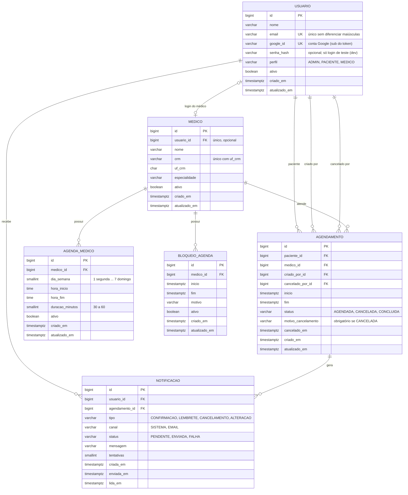

# Modelagem de dados — Agendamentos SA

Versão 1.2 — 18/11/2026. Substitui a versão 1.1 (15/11) e a proposta de 27/10.

Situação: as migrações V1 a V3 estão na master do backend (`src/main/resources/db/migration`). A V4, com as decisões do grupo de 17/11 (DEC-02 e DEC-03), está no [PR #1 do backend](https://github.com/faculdade-ads-senai/agendamentos-sa-backend/pull/1) (branch `feature/v4-decisoes-dec02-dec03`), esperando revisão. Este documento já descreve o banco com a V4. Onde cada ambiente roda está em [AMBIENTES.md](AMBIENTES.md).

## Mudanças da versão 1.2 (V4, decisões de 17/11)

- Login só pelo Google: `usuario` ganha `google_id` (único) e `senha_hash` passa a ser opcional. A senha só existe para o login de teste do perfil `dev`.
- Recepcionista é o próprio administrador: o perfil `RECEPCIONISTA` sai. Valem `ADMIN`, `PACIENTE` e `MEDICO`.
- O médico entra no sistema: `medico.usuario_id` liga o médico ao usuário com que ele faz login.
- A consulta dura de 30 a 60 minutos (era de 5 a 480): o médico escolhe em cada janela da agenda.
- Todo cancelamento exige motivo.
- Todas as decisões que eram proposta foram fechadas (ver o fim do documento).

## Mudanças da versão 1.1

- Clientes: painel web (React + Vite) e aplicativo React + Capacitor (Android), conforme decisão do grupo de 15/11. O banco não muda com isso: os dois clientes usam a mesma API e nenhum acessa o banco direto.
- Perfis: a V2 trocou `ADMIN` por `ADMINISTRADOR` e passou a aceitar `MEDICO` e `RECEPCIONISTA`; a V3 (Yuri, 15/11, junto com o login JWT) voltou para `ADMIN`. A V4 (18/11) tirou `RECEPCIONISTA`.
- Datas de criação e atualização: confirmado que o PostgreSQL cuida delas (padrão `CURRENT_TIMESTAMP` e gatilho). O Hibernate só lê (`@Generated`), como já está nas entidades.
- Novos materiais: script de validação das restrições ([validacao_restricoes.sql](validacao_restricoes.sql)) e dados de demonstração para desenvolvimento (`R__dados_demonstracao.sql` no backend, perfil `dev`).

## Decisões estruturais

| Decisão | Versão 1.1 | Justificativa |
|---|---|---|
| Banco | PostgreSQL 16+ | Confirmado: Flyway no backend e V1 aplicada. Integridade transacional e restrição de conflito de horários no próprio banco. |
| Migrações | Flyway, `ddl-auto=validate` | O banco é definido pelas migrações; o Hibernate só confere se as entidades batem com ele. |
| Clientes | Painel web e app React + Capacitor | Os dois consomem a mesma API REST. |
| Login | Só pelo Google (V4) | Sem senha para guardar nem recuperar; o e-mail já vem confirmado pelo Google. A senha fica só para o login de teste do perfil `dev`. |
| Perfis | `ADMIN`, `PACIENTE` e `MEDICO` (V4) | A recepcionista é o administrador; não há perfil próprio. |
| Médico | Cadastro em `medico` ligado a um usuário `MEDICO` (V4) | O administrador cadastra o médico com o e-mail Google dele; o médico entra e vê a própria agenda. |
| Especialidade | Atributo de médico | Evita CRUD e tabela adicionais antes de existir necessidade real. |
| Unidade de saúde | Fora da versão 1 | Uma única clínica (arquitetura do backend: "apenas um consultório"). |
| Histórico | Derivado de `agendamento` | Cancelados e concluídos permanecem na mesma tabela. Não há prontuário. |
| Exclusão de médico/usuário | Desativação lógica | Preserva vínculos e histórico administrativo. |
| Horário | `TIMESTAMPTZ` | Guarda o instante correto; os clientes exibem em `America/Sao_Paulo`. |
| Concorrência | Restrição de exclusão (GiST) | Dois pedidos simultâneos não conseguem reservar o mesmo médico ou paciente no mesmo intervalo. |
| Datas de auditoria | Banco (padrão + gatilho) | Funcionam também em alterações feitas fora da aplicação. |

## Migrações

Os arquivos ficam no backend, em `src/main/resources/db/migration` (V) e `src/main/resources/db/dev` (R). Mudança de estrutura só entra por nova migração revisada em PR; ninguém altera tabela à mão em produção.

| Versão | Arquivo | Autor | Conteúdo |
|---|---|---|---|
| V1 | `V1__criar_estrutura_inicial.sql` | Luís | Tabelas, restrições, índices e gatilhos descritos aqui. |
| V2 | `V2__atualizar_perfis_usuario.sql` | Yuri | `ADMIN` vira `ADMINISTRADOR`; perfis aceitos: `ADMINISTRADOR`, `PACIENTE`, `MEDICO`, `RECEPCIONISTA`. |
| V3 | `V3__renomear_perfil_admin.sql` | Yuri | `ADMINISTRADOR` volta a ser `ADMIN`; perfis aceitos: `ADMIN`, `PACIENTE`, `MEDICO`, `RECEPCIONISTA`. |
| V4 | `V4__login_google_medico_e_regras_v1.sql` | Luís | `usuario.google_id` e senha opcional; perfil `RECEPCIONISTA` sai (quem tinha vira `ADMIN`); `medico.usuario_id`; duração de 30 a 60 minutos; motivo obrigatório no cancelamento. Ajusta linhas antigas antes de cada restrição nova. |
| R (dev) | `R__dados_demonstracao.sql` | Luís | Dados fictícios para desenvolvimento e demonstração. Só roda com o perfil `dev`, nunca em produção. |

A extensão `btree_gist`, criada pela V1, é confiável desde o PostgreSQL 13: o dono do banco consegue criá-la sem superusuário. O Neon, usado em produção, oferece a extensão.

## Diagrama entidade-relacionamento

## Dicionário e regras por entidade

### `usuario`

- Guarda os dados comuns de quem acessa o sistema.
- `email` é único sem diferenciar maiúsculas e minúsculas (índice em `lower(email)`); a API grava em minúsculas.
- `google_id` guarda o identificador da conta Google (campo `sub` do token). É único e fica vazio até o primeiro login da pessoa.
- `senha_hash` é opcional: só os usuários de demonstração do perfil `dev` têm senha (hash BCrypt), para o login de teste. Nunca aparece nas respostas da API.
- `perfil`: ver "Perfis".
- Um usuário desativado não pode autenticar nem criar agendamentos.

### Perfis

| Perfil | Uso na versão 1 |
|---|---|
| `ADMIN` | Faz também o papel da recepcionista. Gerencia médicos, agendas, bloqueios e pacientes; agenda, cancela e reagenda qualquer consulta, sem prazo mínimo. |
| `PACIENTE` | Entra com o Google, agenda, cancela e reagenda as próprias consultas (até 24 horas antes) e vê o próprio histórico. |
| `MEDICO` | Entra com o Google, vê a própria agenda e as consultas dela e cancela consultas da própria agenda, com motivo. Não reagenda. |

### Login com Google

O banco não guarda nada do Google além do `google_id`. No login, o backend confere o token do Google e procura o usuário:

1. pelo `google_id`;
2. se não achar, pelo `email` (caso de quem o administrador já cadastrou, como médicos), e grava o `google_id`;
3. se não achar nenhum, cria um usuário `PACIENTE`.

Depois disso o backend devolve o JWT do próprio sistema, com o perfil, como já faz hoje.

### `medico`

- `crm` é único em conjunto com `uf_crm`; `uf_crm` aceita duas letras maiúsculas.
- `usuario_id` liga o médico ao usuário `MEDICO` com que ele entra. É único (um usuário, no máximo um médico) e opcional no banco por causa dos médicos cadastrados antes da V4; a API exige o vínculo no cadastro de médico novo.
- Desativar impede novos horários e agendamentos, mas não remove o histórico.

### `agenda_medico`

- Define janelas semanais recorrentes de atendimento.
- `dia_semana` usa ISO-8601: 1 = segunda-feira e 7 = domingo.
- Pode existir mais de uma janela por dia, por exemplo 08:00–12:00 e 13:30–18:00. A mesma janela não se repete para o médico.
- `duracao_minutos` vai de 30 a 60 (V4). O médico escolhe em cada janela, e o sistema divide a janela em horários desse tamanho: com 30 minutos, 08:00, 08:30, 09:00 e assim por diante. O paciente só escolhe um desses horários.

### `bloqueio_agenda`

- Representa férias, reunião, ausência ou bloqueio pontual.
- Um bloqueio ativo retira do resultado qualquer horário que o intercepte.
- A desativação substitui a exclusão física.

### `agendamento`

- Vínculo obrigatório entre paciente, médico e intervalo de atendimento.
- `status` aceita `AGENDADA`, `CANCELADA` ou `CONCLUIDA`.
- A reserva usa intervalo semiaberto `[inicio, fim)`: uma consulta pode começar exatamente quando a anterior termina.
- O banco impede sobreposição de consultas `AGENDADA` para o mesmo médico e para o mesmo paciente. Consultas canceladas ou concluídas não bloqueiam o horário.
- Uma consulta cancelada exige `cancelado_em`, `cancelado_por_id` e `motivo_cancelamento` (V4); as demais não podem ter data nem autor de cancelamento.
- `criado_por_id` distingue um agendamento criado pelo paciente de um criado pelo administrador.
- O reagendamento altera o intervalo da mesma linha e atualiza `atualizado_em`; cancelamentos permanecem para o histórico.
- Não há sintomas, diagnóstico, prescrição ou prontuário.

### `notificacao`

- Mantém o registro exigido pelo RF-028.
- `tipo`: `CONFIRMACAO`, `LEMBRETE`, `CANCELAMENTO` ou `ALTERACAO`.
- `canal`: `SISTEMA` (caixa de entrada no app e no painel) ou `EMAIL`. Cada aviso gera as duas linhas: a de `SISTEMA` aparece na hora; a de `EMAIL` é enviada em segundo plano.
- `status`: `PENDENTE`, `ENVIADA` ou `FALHA`; `tentativas` conta as tentativas de envio.

## Notificações assíncronas (conceito de sistemas distribuídos)

A SA pede ao menos um conceito distribuído aplicado e justificado (offline, cache, mensageria ou sincronização). O banco já suporta um deles sem tabela nova: a **caixa de saída transacional** (*transactional outbox*).

1. Ao confirmar, cancelar ou reagendar, o serviço grava o agendamento e a notificação `PENDENTE` na mesma transação. Ou tudo é gravado, ou nada.
2. Um processo separado (agendador do Spring ou consumidor de fila) lê as notificações `PENDENTE` pelo índice `ix_notificacao_pendente`, envia, marca `ENVIADA` com `enviada_em` ou incrementa `tentativas` e marca `FALHA`.
3. O envio não atrasa nem derruba a operação do paciente: se o canal estiver fora do ar, a consulta continua marcada e a notificação é reenviada depois.

O e-mail sai por uma API HTTP de envio (Brevo, plano gratuito), porque o plano gratuito do Render bloqueia as portas de SMTP. O e-mail de confirmação e o de reagendamento levam um convite de agenda (arquivo `.ics`) que a pessoa adiciona à Google Agenda; o de cancelamento leva o convite de cancelamento. O sistema não grava nada na agenda Google de ninguém. O lembrete de 24 horas é gerado por uma tarefa agendada do backend.

Para mais de uma instância do processo de envio, a leitura usa `SELECT ... FOR UPDATE SKIP LOCKED`, de modo que duas instâncias não enviem a mesma notificação.

## Regras que ficam na aplicação

As validações abaixo dependem de contexto e devem rodar numa transação no backend:

1. O paciente do agendamento deve ser um `usuario` ativo com perfil `PACIENTE`.
2. O médico deve estar ativo.
3. O intervalo precisa caber integralmente em uma janela ativa de `agenda_medico`.
4. O intervalo não pode interceptar `bloqueio_agenda` ativo.
5. O início deve ser futuro no momento da confirmação.
6. O fim deve corresponder à duração configurada na janela.
7. Cancelamento e reagendamento seguem a tabela do DEC-03, no fim do documento: paciente só nas próprias consultas e até 24 horas antes do início; médico só cancela, nas consultas da própria agenda; `ADMIN` em qualquer consulta, sem prazo. Só consultas futuras com status `AGENDADA`.
8. O histórico do paciente sempre filtra pelo usuário autenticado; o do médico, pelo médico ligado ao usuário.
9. Quem reserva bloqueia antes a linha do médico (`SELECT ... FOR UPDATE`), como já faz o módulo de agendas, para não reservar enquanto a agenda ou um bloqueio está sendo alterado.

## Validação

- [validacao_restricoes.sql](validacao_restricoes.sql) roda numa transação e desfaz tudo no fim. Ele confere e-mail duplicado, perfis, conta Google repetida, vínculo médico-usuário, CRM duplicado, janelas, duração e bloqueios inválidos, sobreposição de consultas por médico e por paciente, consultas encostadas, liberação do horário no cancelamento, motivo e regras de cancelamento, valores aceitos nas notificações e a existência dos gatilhos. Cada verificação imprime `OK`; a primeira que falhar interrompe com `FALHOU`.
- Em 18/11 o script passou inteiro num PostgreSQL 18.7 com V1 a V4 e os dados de demonstração. A V4 também foi aplicada num banco que já tinha os dados antigos (janelas de 20 minutos e um usuário `RECEPCIONISTA`): as linhas foram ajustadas e as restrições entraram sem erro. O backend da branch da V4 também subiu com o perfil `dev`: Flyway aplicou V1 a V4, o `ddl-auto=validate` passou e o login dos usuários de demonstração funcionou.
- Concorrência real (duas conexões ao mesmo tempo) não cabe num script só. O roteiro manual está no fim do arquivo.

## Decisões da versão 1 (DEC-02 e DEC-03)

Fechadas pelo grupo em sala em 17/11/2026 (comentários no Trello) e confirmadas pelo Luís em 18/11.

| Item | Decisão |
|---|---|
| Banco | PostgreSQL |
| Unidade de saúde | Clínica única, sem tabela de unidade |
| Especialidade | Atributo do médico |
| Login | Só pelo Google, para todos os perfis. Sem senha e sem recuperação de senha (RF-004 sai da v1). Login de teste com e-mail e senha só no perfil `dev` |
| Perfis | `ADMIN` (faz o papel da recepcionista), `PACIENTE` e `MEDICO`, todos com telas na v1 |
| Duração da consulta | 30 a 60 minutos, definida pelo médico em cada janela |
| Notificações | Caixa de entrada no app e no painel, mais e-mail enviado em segundo plano (Brevo). Sem push no celular |
| Google Agenda | O e-mail leva um convite de agenda (`.ics`); a pessoa adiciona à Google Agenda dela. A disponibilidade continua no sistema |
| Lembrete | 24 horas antes da consulta, pelo sistema (caixa de entrada e e-mail) |
| Divisão do backend | Yuri: módulos 1, 3 e 5 (login com Google, agendamento, notificações e e-mail). Pierre: módulos 2 e 4 (médicos e agenda, histórico) |
| Publicação da API | Render, com o Luís (BE-08) |
| Quem cancela e reagenda | Paciente: as próprias consultas futuras, até 24 horas antes do início. Médico: só cancela, consultas futuras da própria agenda, sem prazo. `ADMIN`: qualquer consulta futura, sem prazo |
| Motivo | Obrigatório em todo cancelamento. No reagendamento é opcional e vai só no texto da notificação |
| Quem é avisado | Toda mudança avisa o paciente e o médico da consulta, menos quem fez a mudança |
| Erros | 404: consulta de outro paciente; 409: horário ocupado; 422: consulta passada, já cancelada ou a menos de 24 horas (paciente) |
